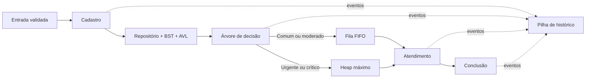

# Central de Atendimento e Priorização


[](https://github.com/DoravanBR/central-atendimento-estruturas-dados-c/actions/workflows/testes.yml)

[](LICENSE)

Trabalho Prático Integrador da disciplina de Estruturas de Dados II, desenvolvido em C11. Além da implementação, este repositório documenta como a inteligência artificial pode apoiar a interpretação do problema, a especificação, a arquitetura e os testes sem substituir a compreensão e as decisões do autor.

## Destaques

- 13 componentes com responsabilidades separadas;
- 7 estruturas trabalhando sobre o mesmo domínio;
- propriedade da memória explicitamente definida;
- integração transacional com rollback;
- 12 testes automáticos;
- comparação experimental entre BST e AVL;
- relatório completo com requisitos, fluxogramas e etapas de implementação;
- prompt reutilizável para planejar projetos futuros com apoio de IA.

## Fluxo principal



## Documentação

| Documento | Conteúdo |
|---|---|
| [Especificação](ESPECIFICACAO.md) | requisitos, regras e decisões tomadas antes da integração |
| [Relatório completo](docs/RELATORIO_COMPLETO_PROJETO.md) | problema, interpretação, arquitetura, fluxogramas, implementação e testes |
| [Relatório completo em PDF](docs/Relatorio_Completo_Planejamento_Arquitetura_Implementacao.pdf) | versão diagramada do relatório técnico |
| [Comparação BST e AVL](RELATORIO.md) | metodologia, métricas, resultados e conclusão experimental |
| [Artigo para LinkedIn](docs/ARTIGO_LINKEDIN.md) | relato sobre IA aplicada ao planejamento e à arquitetura |
| [Prompt reutilizável](docs/PROMPT_PLANEJAMENTO_ARQUITETURA.md) | processo guiado para projetos futuros |

## Autor

```text
Nome: Clovis Campanha Junior
RA: 202510008
Professor: Clerivaldo José Roccia
```

## Situação do projeto

A implementação dos módulos, dos testes unitários e do teste integrado está concluída. O programa compila com:

```text
-std=c11 -Wall -Wextra -pedantic

```
sem erros e sem avisos.

## Objetivo

O sistema cadastra, classifica, localiza e prioriza atendimentos,
integrando diferentes estruturas de dados:
- árvore binária de decisão;
- fila encadeada;
- pilha dinâmica;
- árvore binária de busca (BST);
- árvore AVL;
- heap máximo;
- repositório dinâmico central.
Cada estrutura atende a uma responsabilidade diferente, enquanto os
objetos Atendimento são criados uma única vez e compartilhados por
ponteiros.

## Funcionalidades
- Cadastro com código e ordem de chegada gerados automaticamente.
- Validação de prioridade entre 1 e 10.
- Classificação por árvore binária de perguntas.
- Encaminhamento de comuns e moderados para fila FIFO.
- Encaminhamento de urgentes e críticos para heap máximo.
- Desempate no heap pela ordem de chegada.
- Busca por código na BST e na AVL.
- Medição de altura, comparações e rotações.
- Histórico de operações em pilha.
- Conclusão por alteração de status.
- Validação das propriedades da BST, AVL e heap.
- Experimentos com inserções crescentes, decrescentes e pseudoaleatórias.

## Organização dos arquivos

| Arquivo | Responsabilidade |
|---|---|
| `main.c` | Menu e interação com o usuário. |
| `atendimento.c/.h` | Registro, status, classificação, criação e exibição. |
| `entrada.c/.h` | Leitura segura de texto e números. |
| `repositorio.c/.h` | Armazenamento central dos atendimentos. |
| `fila.c/.h` | Fila FIFO de atendimentos comuns e moderados. |
| `pilha.c/.h` | Histórico de operações do mais recente ao mais antigo. |
| `arvore_decisao.c/.h` | Classificação por perguntas de sim ou não. |
| `bst.c/.h` | Índice por código sem balanceamento automático. |
| `avl.c/.h` | Índice balanceado por código e contagem de rotações. |
| `heap.c/.h` | Priorização de urgentes e críticos. |
| `validacao.c/.h` | Verificação das propriedades de BST, AVL e heap. |
| `sistema.c/.h` | Integração e regras transacionais dos módulos. |
| `experimentos.c/.h` | Comparação experimental entre BST e AVL. |
| `testes/` | Testes unitários, integrados e arquivos de entrada. |
| `ESPECIFICACAO.md` | Requisitos e decisões tomadas antes da implementação. |
| `Makefile` | Regras opcionais de compilação com `make`. |

## Estados do atendimento

O atendimento segue estas transições:

```text
ABERTO
  |
  v
CLASSIFICADO
  |
  v
EM_ATENDIMENTO
  |
  v
CONCLUIDO
```

Não são permitidos saltos, retornos a estados anteriores ou repetição da mesma transição.

## Classificação
A árvore de decisão possui três perguntas e quatro folhas:
```text
Serviço totalmente indisponível?
├── Sim: afeta várias pessoas?
│   ├── Sim  → crítica
│   └── Não  → urgente
└── Não: impede o trabalho?
    ├── Sim  → moderada
    └── Não  → comum
```

`Encaminhamento`:
- comum ou moderada: fila;
- urgente ou crítica: heap máximo.

## Propriedade da memória

Cada `Atendimento` é alocado uma única vez.

O repositório é o proprietário dos objetos e é o único módulo que chama
`atendimento_destruir` sobre os registros armazenados.

As outras estruturas guardam ponteiros emprestados:

```text
Repositório ─┐
Fila ────────┤
Heap ────────┤──> mesmo Atendimento
BST ─────────┤
AVL ─────────┘
```
Fila, heap, BST e AVL liberam somente seus nós ou vetores internos.

A ordem de destruição do sistema é:
1. fila;
2. heap;
3. BST;
4. AVL;
5. pilha;
6. árvore de decisão;
7. repositório.
O repositório fica por último porque destrói os atendimentos compartilhados.

## Comportamento transacional

Os contadores `proximo_codigo` e `proxima_ordem` só avançam depois que o
cadastro foi concluído no repositório, BST, AVL e histórico.

Durante a classificação:
1. o atendimento é localizado;
2. seu status e classificação são confirmados;
3. ele é inserido na fila ou no heap;
4. o evento é registrado no histórico.
Se a inserção na fila ou no heap falhar, status e classificação retornam
ao estado anterior.

Quando uma falha de memória ocorre depois de uma integração que não pode
ser desfeita com segurança, o sistema libera todo o estado atual. Essa
decisão evita estruturas parcialmente sincronizadas e vazamentos de
memória.

## Regras do heap

O heap máximo compara os atendimentos nesta ordem:
1. maior prioridade;
2. em caso de empate, menor ordem_chegada.
A prioridade é informada no cadastro para todos os atendimentos, mas a
fila ignora esse campo.

## Histórico

A pilha guarda cópias de RegistroHistorico, não ponteiros para
Atendimento.

Cada evento recebe uma sequência própria e crescente, iniciada em 1.
São registrados:
- cadastro;
- classificação;
- início do atendimento;
- conclusão.

## Compilação

### Windows com GCC

Na pasta principal do projeto:

```powershell
gcc -std=c11 -Wall -Wextra -pedantic main.c atendimento.c entrada.c repositorio.c pilha.c fila.c bst.c avl.c heap.c arvore_decisao.c validacao.c sistema.c experimentos.c -I . -o central.exe

Execução:

.\central.exe
```
### Com Make

É necessário possuir make instalado, por exemplo pelo MSYS2.

```
make
make run

Para remover objetos e executável:

make clean
```
## Menu

```
1. Cadastrar atendimento
2. Classificar atendimento
3. Consultar pela BST
4. Consultar pela AVL
5. Exibir percursos e medidas da BST
6. Exibir percursos e medidas da AVL
7. Exibir fila de atendimentos
8. Chamar próximo atendimento comum
9. Exibir heap de prioridades
10. Chamar atendimento prioritário
11. Concluir atendimento
12. Exibir histórico
13. Comparar BST e AVL
14. Validar estruturas
15. Exibir árvore de decisão
0. Encerrar
```
Uso básico
1. Cadastre um ou mais atendimentos.
2. Anote os códigos gerados automaticamente.
3. Classifique cada atendimento.
4. Consulte a fila ou o heap.
5. Chame o próximo atendimento.
6. Conclua usando o código.
7. Consulte o histórico e valide as estruturas.
8. Encerre com a opção 0 para liberar a memória.

## Testes

Os testes utilizam `assert` e devem ser executados a partir da pasta
principal do projeto.

### Arquivos disponíveis:

| Teste | Cobertura principal |
|---|---|
| `teste_atendimento.c` | Criação, status, classificação e validações. |
| `teste_entrada.c` | Texto, inteiros, positivos e entradas inválidas. |
| `teste_repositorio.c` | Inserção, busca, expansão e propriedade da memória. |
| `teste_pilha.c` | LIFO, sequência, topo e destruição. |
| `teste_fila.c` | FIFO, encaminhamento e preservação dos objetos. |
| `teste_bst.c` | Inserção, busca, altura, percursos e degeneração. |
| `teste_avl.c` | Casos LL, RR, LR, RL, alturas e rotações. |
| `teste_heap.c` | Prioridade, desempate, subida, descida e expansão. |
| `teste_arvore_decisao.c` | Três perguntas, quatro folhas e quatro resultados. |
| `teste_validacao.c` | Estruturas válidas e corrupções controladas. |
| `teste_experimentos.c` | Comparação crescente, decrescente e pseudoaleatória. |
| `teste_sistema.c` | Fluxo integrado completo. |

### Teste integrado

Compilação:

```powershell
gcc -std=c11 -Wall -Wextra -pedantic atendimento.c entrada.c repositorio.c pilha.c fila.c bst.c avl.c heap.c arvore_decisao.c validacao.c sistema.c testes\teste_sistema.c -I . -o teste_sistema.exe
```

Execução:

```
.\teste_sistema.exe
```

O teste utiliza automaticamente:

```
testes/dados_sistema.txt
```
### Arquivos automáticos de entrada

- `testes/dados_entrada.txt`: teste do módulo de entrada;
- `testes/dados_arvore_decisao.txt`: quatro caminhos da árvore;
- `testes/dados_sistema.txt`: quatro classificações do teste integrado.

Esses testes não exigem digitação manual porque redirecionam `stdin` com
`freopen`.

## Resultados experimentais observados

### Com vinte códigos:

| Ordem | Altura BST | Altura AVL | Rotações AVL |
|---|---:|---:|---:|
| Crescente | 19 | 4 | 15 |
| Decrescente | 19 | 4 | 15 |
| Pseudoaleatória fixa | 5 | 4 | 1 |


Os percursos em ordem das duas árvores apresentaram os códigos de 1 a 20,
confirmando a ordenação.

A AVL não exige menos comparações em toda busca isolada. Uma chave que
esteja na raiz da BST pode ser encontrada imediatamente. Sua vantagem é
manter a altura controlada e oferecer comportamento mais estável.

## Requisitos técnicos

- Linguagem C11.
- Somente biblioteca padrão da linguagem C.
- GCC com `-Wall -Wextra -pedantic`.
- Alocação dinâmica para as estruturas exigidas.
- Cabeçalhos protegidos contra inclusão múltipla.
- Ausência de variáveis globais para armazenar as estruturas do sistema.
- Liberação completa da memória no encerramento.

## Limitações

- Os dados existem somente durante a execução; não há persistência em arquivo.
- A árvore de decisão possui perguntas fixas definidas no código.
- Não existe remoção física completa de um atendimento de todos os índices.
- A conclusão é representada pela alteração para `STATUS_CONCLUIDO`.
- A AVL não possui remoção individual.
- O heap remove somente a raiz.
- Em uma falha crítica após integração parcial não reversível, o sistema
  libera todo o estado para evitar inconsistência.

## Decisões de implementação

- Códigos e ordens começam em 1 e são gerados automaticamente.
- A prioridade é informada no cadastro para todos os atendimentos.
- A fila considera apenas ordem de chegada.
- O heap considera prioridade e, em empate, antiguidade.
- Árvore vazia possui altura `-1`; folha possui altura `0`.
- Rotações simples da AVL contam 1; rotações duplas contam 2.
- Buscas contam um nó visitado como uma comparação.
- A ordem pseudoaleatória dos experimentos é fixa para permitir repetição.

## Referências e apoio

O projeto foi desenvolvido a partir do enunciado da disciplina, dos
estudos individuais sobre estruturas de dados e de orientação didática
assistida por IA.

A assistência foi usada para discutir requisitos, modularização,
invariantes, gerenciamento de memória e planejamento de testes. O código
foi digitado, analisado, compilado e testado módulo por módulo durante o
processo de aprendizagem.

Antes da apresentação, o autor deve ser capaz de explicar e modificar:

- ponteiros simples e duplos;
- alocação e liberação de memória;
- recursividade;
- fila e pilha;
- propriedades da BST;
- fatores e rotações AVL;
- subida e descida no heap;
- compartilhamento dos atendimentos;
- integração e rollback.

## Licença

Este projeto está disponível sob a [Licença MIT](LICENSE). É permitido usar, estudar, modificar e distribuir o código, desde que o aviso de copyright e o texto da licença sejam preservados.

## Evoluções futuras

Este repositório continuará sendo utilizado como laboratório para integrar conhecimentos de outras disciplinas ao projeto original de Estruturas de Dados.

A próxima evolução planejada é aplicar conceitos de **Sistemas Operacionais e escalonamento de processos** para automatizar a execução dos atendimentos. Em vez de depender exclusivamente das opções manuais “chamar próximo” e “chamar prioritário”, um escalonador poderá selecionar e iniciar atendimentos conforme uma política configurável.

Possíveis políticas incluem:

- FCFS/FIFO para preservar a ordem de chegada;
- prioridade para casos urgentes e críticos;
- Round Robin com quantum de atendimento;
- envelhecimento de prioridade para evitar espera indefinida;
- escalonamento híbrido entre fila comum e heap prioritário;
- simulação preemptiva, permitindo interromper e retomar um atendimento.

Também estão previstas evoluções relacionadas a persistência de dados, concorrência, interface, métricas e observabilidade. O planejamento completo está disponível no [roadmap do projeto](docs/ROADMAP.md).
