# Relatório completo de planejamento, arquitetura e implementação

## Central de Atendimento e Priorização com Estruturas de Dados em C

**Autor:** Clovis Campanha Junior  
**RA:** 202510008  
**Disciplina:** Estruturas de Dados II  
**Professor:** Clerivaldo José Roccia  
**Linguagem:** C11  

---

## 1. Visão geral

Este documento registra o ciclo completo de desenvolvimento de uma Central de Atendimento e Priorização: compreensão do problema, transformação do enunciado em requisitos, definição das regras, desenho da arquitetura, modularização, implementação incremental, testes e análise dos resultados.

O projeto também funciona como estudo de caso sobre o uso responsável de inteligência artificial no desenvolvimento de software. A IA foi utilizada como parceira de raciocínio para fazer perguntas, discutir alternativas, revisar invariantes, explicar conceitos e planejar testes. As decisões foram confirmadas pelo autor, e cada módulo foi estudado, digitado, compilado e testado de forma incremental.

## 2. Problema

Era necessário construir, em C, um sistema capaz de administrar chamados de atendimento e integrar diferentes estruturas de dados estudadas na disciplina:

- árvore binária de decisão para classificar chamados;
- fila para atendimentos comuns e moderados;
- heap máximo para atendimentos urgentes e críticos;
- pilha para o histórico de operações;
- BST e AVL para indexação e busca por código;
- vetor dinâmico como repositório central;
- experimentos para comparar o comportamento da BST e da AVL.

O desafio não era apenas implementar estruturas isoladas. Elas precisavam cooperar sobre os mesmos atendimentos sem criar cópias incoerentes, perder dados, quebrar as regras de estado ou liberar a mesma memória mais de uma vez.

## 3. Análise e interpretação do problema

### 3.1 Entradas, processamento e saídas

**Entradas:** descrição do chamado, prioridade de 1 a 10, código para consultas e respostas de sim ou não na classificação.

**Processamento:** validação, geração automática de identificadores, armazenamento, indexação, classificação, roteamento, ordenação, transição de status, registro histórico e verificação das estruturas.

**Saídas:** confirmação das operações, dados do atendimento, fila, heap, histórico, percursos das árvores, métricas, erros de validação e resultados experimentais.

### 3.2 Entidades e metadados

A entidade principal é `Atendimento`. Ela possui código, ordem de chegada, descrição, prioridade, classificação e status. Código e ordem são contadores independentes e crescentes.

Os metadados que controlam o ciclo de vida são:

- classificação: não definida, comum, moderada, urgente ou crítica;
- status: aberto, classificado, em atendimento ou concluído;
- prioridade: inteiro entre 1 e 10;
- ordem de chegada: critério de desempate no heap;
- sequência histórica: contador próprio dos eventos.

### 3.3 Responsabilidades extraídas do problema

O armazenamento e a consulta são preocupações diferentes. O repositório conserva os objetos; BST e AVL oferecem índices de busca. Da mesma forma, fila e heap não são repositórios: representam listas de espera com políticas distintas. A pilha registra fatos ocorridos, sem controlar o estado atual do atendimento.

Essa separação evitou transformar uma única estrutura em responsável por tudo e permitiu testar cada regra isoladamente.

### 3.4 Riscos identificados antes do código

- ponteiros nulos e entradas inválidas;
- código duplicado nos índices;
- falha de alocação durante uma operação que altera várias estruturas;
- avanço de contadores antes da confirmação do cadastro;
- transições de status fora de ordem;
- atendimento classificado duas vezes;
- duplicação ou dupla liberação do mesmo objeto;
- perda da estabilidade em prioridades empatadas;
- BST degenerada por ordem de inserção desfavorável;
- altura incorreta ou fator de balanceamento inválido na AVL.

## 4. Requisitos

### 4.1 Requisitos funcionais

| ID | Requisito | Evidência de implementação |
|---|---|---|
| RF01 | Cadastrar atendimento com descrição e prioridade | `sistema_cadastrar` e módulo `atendimento` |
| RF02 | Gerar código e ordem automaticamente | contadores em `Sistema` |
| RF03 | Classificar por perguntas binárias | `arvore_decisao` |
| RF04 | Encaminhar comum/moderado para fila | `fila` e `sistema_classificar` |
| RF05 | Encaminhar urgente/crítico para heap | `heap` e `sistema_classificar` |
| RF06 | Buscar atendimento por código | `bst_buscar` e `avl_buscar` |
| RF07 | Chamar o próximo comum por FIFO | `fila_desenfileirar` |
| RF08 | Chamar o prioritário | `heap_remover_raiz` |
| RF09 | Concluir atendimento em andamento | `sistema_concluir` |
| RF10 | Registrar eventos em ordem LIFO | `pilha` |
| RF11 | Exibir percursos e métricas | BST, AVL e menu |
| RF12 | Validar propriedades internas | `validacao` |
| RF13 | Comparar experimentalmente BST e AVL | `experimentos` |
| RF14 | Liberar toda a memória no encerramento | funções `destruir` |

### 4.2 Requisitos não funcionais

- usar C11 e somente a biblioteca padrão;
- compilar com `-Wall -Wextra -pedantic` sem avisos;
- usar alocação dinâmica nas estruturas exigidas;
- modularizar interfaces em `.h` e implementações em `.c`;
- evitar variáveis globais para o estado do sistema;
- retornar códigos de resultado em vez de encerrar silenciosamente;
- manter testes automáticos e repetíveis;
- preservar a consistência em falhas de inserção;
- documentar propriedade e liberação da memória.

## 5. Regras de negócio e invariantes

### 5.1 Identificadores

- `proximo_codigo` e `proxima_ordem` começam em 1;
- ambos são positivos e independentes;
- só avançam após o cadastro ser confirmado nas estruturas necessárias;
- cada código é único.

### 5.2 Prioridade e encaminhamento

- a prioridade informada deve estar entre 1 e 10;
- comum e moderado entram na fila FIFO;
- urgente e crítico entram no heap máximo;
- no heap, a maior prioridade vem primeiro;
- em empate, o atendimento mais antigo, de menor ordem, vem primeiro.

### 5.3 Máquina de estados

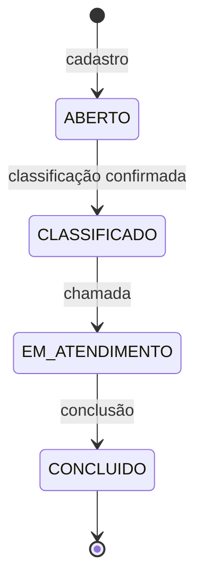

Saltos, retornos e repetição de transição são inválidos.

### 5.4 Classificação

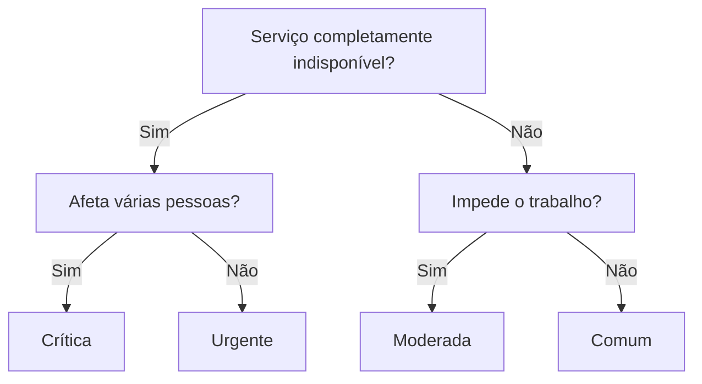

### 5.5 Propriedade da memória

Cada `Atendimento` é criado uma única vez. O repositório é seu proprietário e o único módulo autorizado a destruí-lo. Fila, heap, BST e AVL guardam ponteiros emprestados para o mesmo objeto.

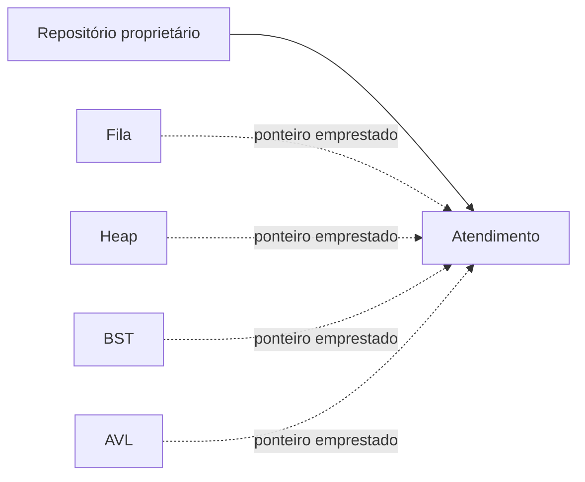

A ordem de destruição é fila, heap, BST, AVL, pilha, árvore de decisão e, por último, repositório.

### 5.6 Convenções das árvores

- árvore vazia tem altura -1;
- folha tem altura 0;
- uma comparação de busca corresponde a um nó visitado;
- rotação simples da AVL conta 1;
- rotação dupla conta 2;
- percurso em ordem deve manter os códigos crescentes.

## 6. Arquitetura da solução

### 6.1 Fluxo geral: entrada, processamento e saída

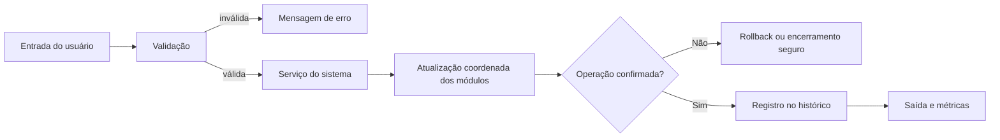

### 6.2 Componentes

| Módulo | Responsabilidade | Estrutura principal |
|---|---|---|
| `main` | menu e orquestração da interface | laço de interação |
| `entrada` | leitura e conversão segura | buffers locais |
| `atendimento` | modelo e regras de estado | `Atendimento` |
| `repositorio` | propriedade e armazenamento | vetor dinâmico |
| `pilha` | histórico recente | lista encadeada LIFO |
| `fila` | espera comum/moderada | lista encadeada FIFO |
| `heap` | espera urgente/crítica | heap máximo em vetor |
| `bst` | índice simples por código | árvore binária de busca |
| `avl` | índice balanceado por código | árvore AVL |
| `arvore_decisao` | classificação | árvore binária de perguntas |
| `validacao` | verificação de invariantes | funções recursivas |
| `sistema` | casos de uso e transações | composição dos módulos |
| `experimentos` | comparação BST/AVL | cenários reproduzíveis |

### 6.3 Dependências

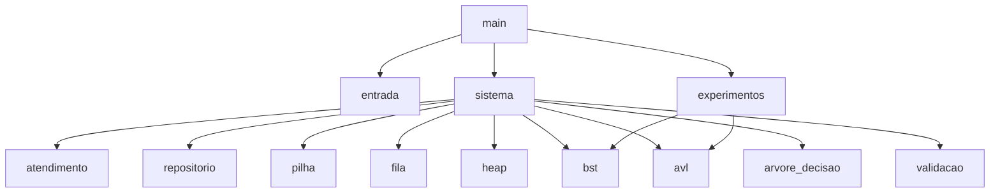

## 7. Fluxo de trabalho de cada módulo

### 7.1 `entrada`

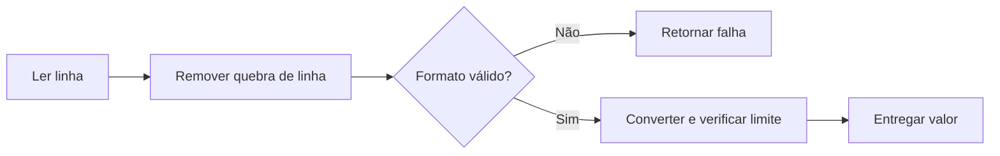

Evita deixar caracteres pendentes em `stdin` e separa a interface das regras de domínio.

### 7.2 `atendimento`

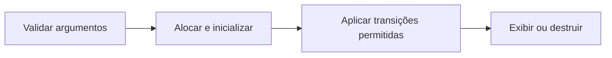

Centraliza o modelo, os textos dos enums, a prioridade válida e a máquina de estados.

### 7.3 `repositorio`

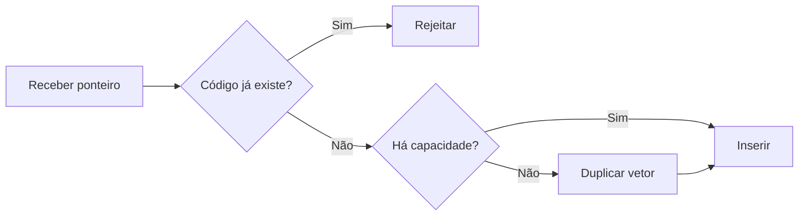

É a fonte de propriedade dos objetos. Expande de 8 em 8 por duplicação geométrica da capacidade.

### 7.4 `pilha`

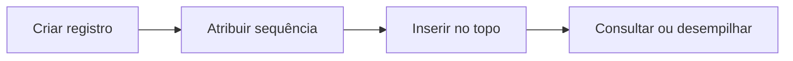

Guarda cópias de `RegistroHistorico`, para que o registro não dependa da vida de um nó externo.

### 7.5 `fila`

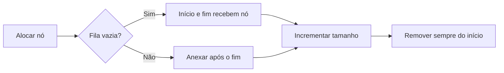

Mantém a ordem de chegada dos atendimentos comuns e moderados.

### 7.6 `heap`

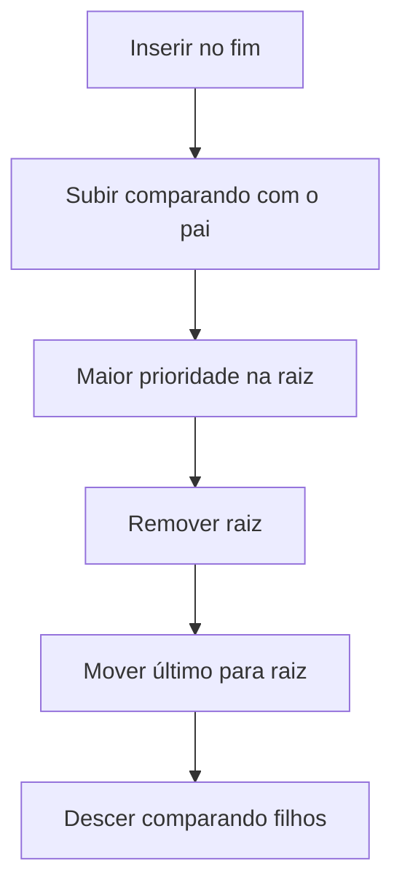

A função de precedência combina prioridade e antiguidade, tornando o desempate determinístico.

### 7.7 `bst`

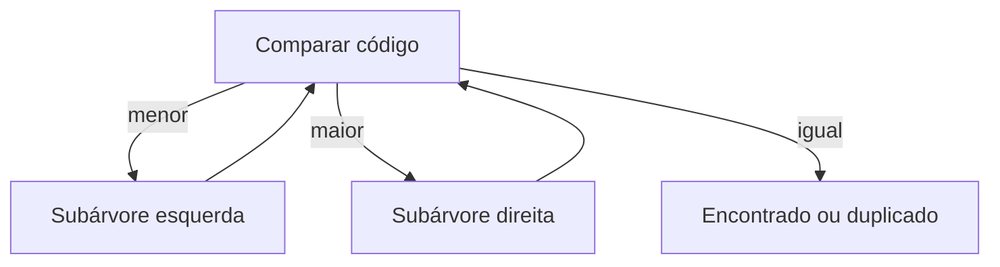

Oferece inserção, busca, altura e percursos, mas sua forma depende da ordem de inserção.

### 7.8 `avl`

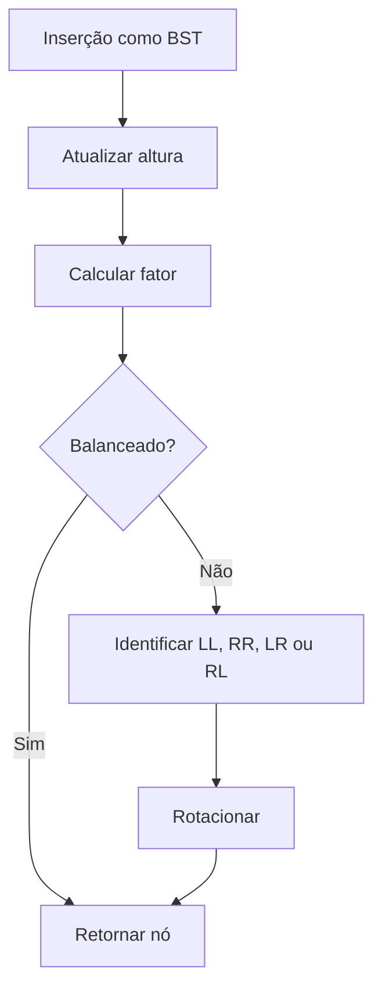

O rebalanceamento é realizado no retorno da recursão, depois de inserir o novo nó.

### 7.9 `arvore_decisao`

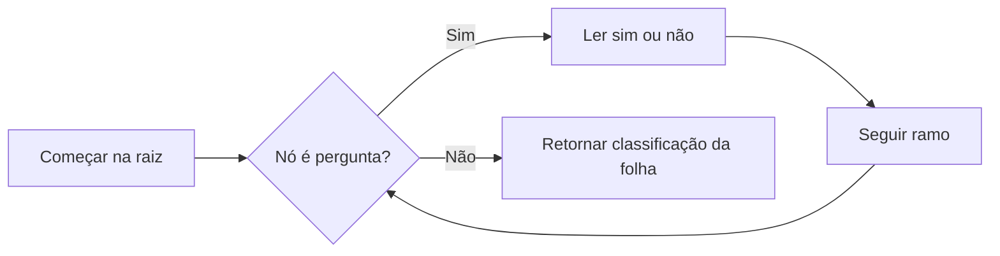

Separa a política de classificação da leitura de dados.

### 7.10 `validacao`

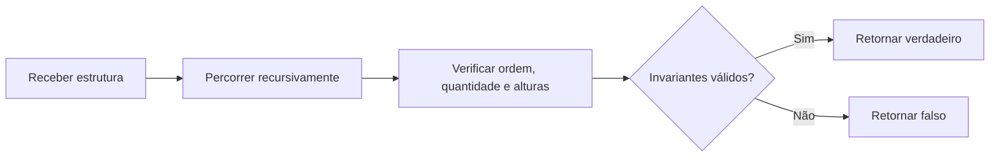

Confirma propriedades da BST, AVL e heap sem modificar seu conteúdo.

### 7.11 `sistema`

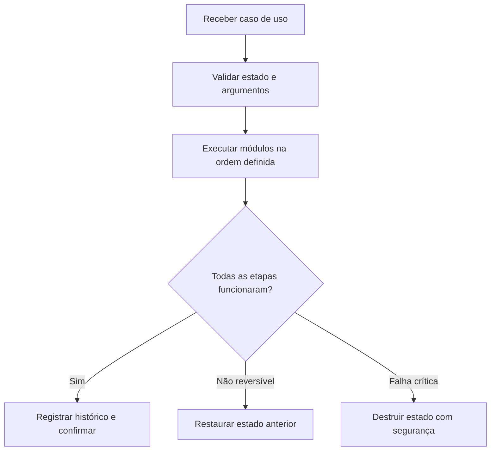

É a camada que impede que `main` conheça detalhes de cada estrutura.

### 7.12 `experimentos`

### 7.13 `main`

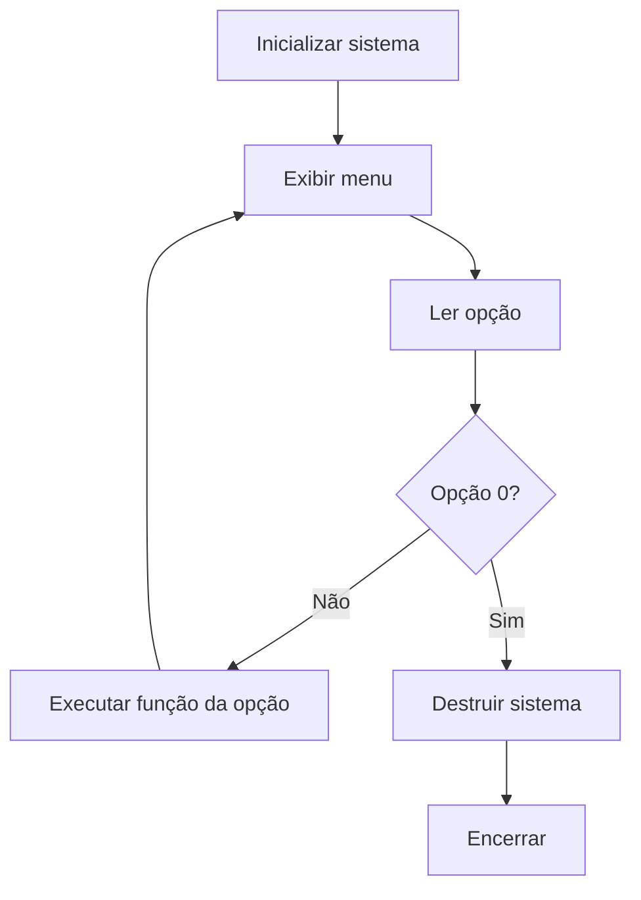

O `while (1)` mantém o menu ativo; o `break` da opção zero termina o laço de forma controlada.

## 8. Fluxograma da implementação

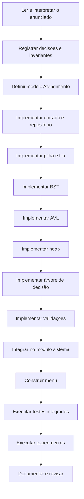

Em todas as etapas foi aplicado o ciclo: entender a responsabilidade, definir a interface, implementar, compilar com avisos habilitados, testar casos válidos e inválidos e somente então avançar.

## 9. Definição da implementação por etapas

### Etapa 1 - modelo de domínio

Foram criados enums para status e classificação e a estrutura `Atendimento`. As funções de validação ficaram próximas aos dados que protegem. Isso estabeleceu o vocabulário comum dos demais módulos.

### Etapa 2 - entrada segura

A leitura foi baseada em linha completa e conversão posterior. O objetivo foi diferenciar fim de arquivo, formato inválido e valor fora do intervalo. Os testes automatizados usam `freopen`, dispensando digitação no terminal.

### Etapa 3 - armazenamento e propriedade

O repositório dinâmico passou a ser dono dos atendimentos. Sua expansão usa novo bloco de memória e só substitui o vetor antigo após sucesso. Essa decisão definiu quem libera cada recurso.

### Etapa 4 - histórico e espera FIFO

A pilha foi implementada com inserção e remoção no topo. A fila recebeu ponteiros emprestados e manteve início e fim para operações constantes.

### Etapa 5 - índices de busca

A BST foi criada como referência de busca não balanceada. Em seguida, a AVL reaproveitou a regra de ordenação e acrescentou altura, fator de balanceamento, rotações e função auxiliar `rebalancear`.

### Etapa 6 - prioridade

O heap máximo foi armazenado em vetor. A inserção usa subida; a remoção usa descida. A comparação foi concentrada em `tem_precedencia`, evitando repetir a regra de prioridade e desempate.

### Etapa 7 - classificação

A árvore de decisão foi montada com nós de pergunta e folhas de resultado. A classificação percorre a árvore conforme as respostas e não conhece fila nem heap.

### Etapa 8 - validações estruturais

Foram criadas rotinas independentes para verificar limites da BST, alturas e fatores da AVL e precedência entre pais e filhos do heap.

### Etapa 9 - integração transacional

O módulo `sistema` compôs todos os anteriores. No cadastro, os contadores só avançam ao final. Na classificação, status e classificação são confirmados antes do roteamento conforme a regra escolhida; se fila ou heap falhar, os valores anteriores são restaurados.

### Etapa 10 - interface

O menu foi dividido em pequenas funções por opção. Ele traduz entradas e resultados, mas não implementa regras das estruturas.

### Etapa 11 - testes e experimentos

Cada módulo recebeu testes com `assert`. Depois foi realizado um teste integrado de cadastro, classificação, chamada e conclusão. Os experimentos inseriram 20 códigos em ordem crescente, decrescente e pseudoaleatória fixa.

### Etapa 12 - documentação e revisão

Foram produzidos especificação, README, relatório experimental e este relatório completo. A revisão verificou coerência entre decisões, código, testes e resultados.

## 10. Implementação dos principais casos de uso

### 10.1 Inicialização

1. preparar todos os ponteiros e contadores em estado seguro;
2. inicializar repositório e heap, que podem alocar memória;
3. inicializar fila, pilha, BST e AVL;
4. construir a árvore de decisão;
5. marcar o sistema como pronto;
6. em qualquer falha, destruir apenas o que já foi preparado.

### 10.2 Cadastro

1. validar descrição e prioridade;
2. criar `Atendimento` com o próximo código e ordem;
3. inserir no repositório;
4. inserir o mesmo ponteiro na BST e na AVL;
5. registrar o cadastro na pilha;
6. avançar os contadores somente após confirmação;
7. tratar falhas sem deixar índices divergentes.

### 10.3 Classificação

1. localizar o atendimento pelo código;
2. exigir `STATUS_ABERTO` e classificação ainda não definida;
3. percorrer a árvore de decisão;
4. confirmar classificação e mudar para `STATUS_CLASSIFICADO`;
5. inserir na fila ou heap;
6. restaurar o estado anterior se o roteamento falhar;
7. empilhar o evento.

### 10.4 Chamada

Para comuns e moderados, remover o início da fila. Para urgentes e críticos, remover a raiz do heap. Em ambos os casos, mudar para `STATUS_EM_ATENDIMENTO` e registrar a operação.

### 10.5 Conclusão

Buscar pelo código, exigir que esteja em atendimento, mudar para `STATUS_CONCLUIDO` e registrar no histórico.

### 10.6 Consulta e validação

As consultas percorrem BST ou AVL e contam nós visitados. A validação executa verificações independentes nas estruturas e informa inconsistência sem alterar o sistema.

### 10.7 Encerramento

As estruturas que possuem ponteiros emprestados são destruídas primeiro. O repositório é destruído por último e libera cada `Atendimento` uma única vez. Os campos voltam ao estado vazio, permitindo destruição repetida segura.

## 11. Estratégia de testes

Foram construídos 12 executáveis de teste:

| Teste | Casos principais |
|---|---|
| atendimento | criação, prioridade, classificação e estados |
| entrada | texto, inteiro, positivo e entradas inválidas |
| repositório | inserção, duplicidade, busca e expansão |
| pilha | LIFO, topo, sequência e destruição |
| fila | FIFO, início, remoção e lista vazia |
| BST | inserção, busca, altura e três percursos |
| AVL | LL, RR, LR, RL, altura e rotações |
| heap | precedência, empate, subida, descida e expansão |
| árvore de decisão | quatro caminhos e quatro classificações |
| validação | estruturas válidas e corrupções controladas |
| experimentos | três ordens de inserção reproduzíveis |
| sistema | fluxo integrado completo |

Todos foram compilados em C11 com `-Wall -Wextra -pedantic` e concluíram com código de saída zero. Entradas automáticas tornaram os testes reproduzíveis.

## 12. Resultados experimentais

| Ordem | Altura BST | Altura AVL | Rotações AVL |
|---|---:|---:|---:|
| crescente | 19 | 4 | 15 |
| decrescente | 19 | 4 | 15 |
| pseudoaleatória fixa | 5 | 4 | 1 |

As ordens crescente e decrescente degeneraram a BST em uma estrutura semelhante a uma lista. A AVL manteve altura 4 por meio de rotações. Na ordem pseudoaleatória, ambas ficaram próximas, mostrando que o balanceamento fornece garantia estrutural, mas não significa menos comparações em toda busca isolada.

## 13. Como a IA foi utilizada

### 13.1 Usos adequados neste projeto

- decompor o enunciado em perguntas menores;
- tornar decisões implícitas explícitas;
- comparar alternativas de arquitetura;
- explicar ponteiros, `const`, casts, recursão e invariantes;
- revisar interfaces antes da implementação;
- sugerir casos de erro e testes de borda;
- apontar inconsistências entre documentação e código;
- ajudar a interpretar resultados experimentais.

### 13.2 O que permaneceu sob responsabilidade humana

- compreender o problema e confirmar cada regra;
- escolher as decisões que alteravam o comportamento;
- escrever e revisar o código linha por linha;
- executar, depurar e entender os testes;
- ser capaz de explicar as estruturas e modificá-las;
- assumir autoria e responsabilidade pelo resultado.

### 13.3 Método recomendado de colaboração

1. apresentar o problema e o contexto;
2. pedir perguntas de esclarecimento, uma por vez;
3. registrar decisões em uma especificação viva;
4. solicitar alternativas com vantagens e riscos;
5. definir módulos, contratos e invariantes antes do código;
6. implementar em partes pequenas;
7. pedir explicação de cada trecho não compreendido;
8. testar cada módulo antes da integração;
9. confrontar sugestões da IA com execução real;
10. documentar como a assistência foi usada.

Esse processo preserva o aprendizado. A IA amplia a capacidade de analisar e revisar; ela não elimina a necessidade de compreender.

## 14. Limitações e evoluções futuras

- os dados não persistem após o encerramento;
- a árvore de decisão é fixa;
- não há remoção física global de atendimento;
- a AVL não implementa remoção individual;
- o heap remove somente a raiz;
- a interface é textual;
- testes de memória com ferramentas especializadas podem ser acrescentados;
- o projeto pode receber CI, documentação de API e persistência.

## 15. Conclusão

O projeto demonstrou que integrar estruturas de dados exige mais do que conhecer seus algoritmos isoladamente. Foi necessário definir propriedade da memória, contratos entre módulos, regras de estado, ordem das operações, rollback e evidências de teste.

O uso orientado da IA ajudou a transformar um enunciado amplo em uma solução verificável. O principal ganho não foi obter código automaticamente, mas tornar o raciocínio explícito: perguntar, decidir, implementar, testar e documentar. Esse é o modelo que pode ser reaplicado em projetos futuros.

