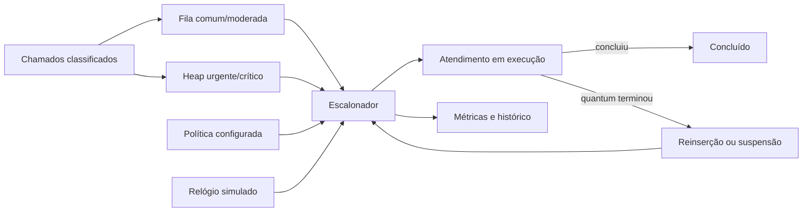

# Roadmap de evolução interdisciplinar

## Objetivo

Evoluir a Central de Atendimento e Priorização como um laboratório prático, incorporando conceitos de outras disciplinas sem perder a modularização, os testes e a rastreabilidade das decisões.

O sistema atual permanece como versão-base: o usuário cadastra, classifica e chama atendimentos manualmente. Cada evolução deverá ser implementada em etapas pequenas, possuir critérios de aceitação e preservar os testes existentes.

## Princípios para as próximas versões

- manter cada responsabilidade em um módulo próprio;
- preservar compatibilidade com o fluxo manual enquanto o automático é desenvolvido;
- registrar decisões antes de alterar o código;
- associar cada requisito novo a testes;
- comparar políticas com métricas reproduzíveis;
- explicar no relatório como cada disciplina contribuiu para a solução;
- utilizar IA para apoiar análise, alternativas e revisão, mantendo as decisões sob responsabilidade do autor.

## Fase 1 - Escalonamento automático de atendimentos

### Relação com a disciplina

Aplicação de conceitos de Sistemas Operacionais, especialmente escalonamento de processos. Cada atendimento poderá ser tratado como uma unidade de trabalho aguardando tempo de execução.

### Problema a resolver

Atualmente, a mudança de `STATUS_CLASSIFICADO` para `STATUS_EM_ATENDIMENTO` depende de uma opção manual do menu. A evolução deverá permitir que um módulo escalonador escolha automaticamente o próximo atendimento conforme uma política definida.

### Novos conceitos do domínio

- **política de escalonamento:** regra usada para selecionar o próximo atendimento;
- **quantum:** quantidade simulada de tempo concedida a um atendimento;
- **tempo de espera:** diferença entre chegada e início da execução;
- **tempo de retorno:** diferença entre chegada e conclusão;
- **preempção:** interrupção temporária de um atendimento;
- **envelhecimento:** aumento gradual da precedência de quem espera há muito tempo;
- **estado suspenso:** estado opcional para um atendimento interrompido.

### Políticas candidatas

| Política | Uso no projeto | Estrutura relacionada |
|---|---|---|
| FCFS/FIFO | executar pela ordem de chegada | fila |
| prioridade não preemptiva | executar maior prioridade primeiro | heap máximo |
| Round Robin | alternar atendimentos por quantum | fila circular |
| prioridade com envelhecimento | evitar starvation | heap com prioridade efetiva |
| multinível | separar classes em filas distintas | múltiplas filas e heap |
| híbrida | reservar capacidade para comuns e prioritários | fila + heap |

### Arquitetura inicialmente proposta

O módulo sugerido é `escalonador.c/.h`. Ele deverá usar as interfaces públicas de fila e heap, sem acessar diretamente seus nós ou vetores internos.

### Etapas planejadas

1. definir relógio e duração simulados;
2. criar métricas de espera, resposta e retorno;
3. extrair a seleção manual para uma interface de política;
4. implementar FCFS automático preservando o fluxo atual;
5. implementar prioridade não preemptiva;
6. comparar as duas políticas com cenários fixos;
7. criar Round Robin e definir o quantum;
8. avaliar a necessidade de novos estados;
9. implementar envelhecimento para evitar starvation;
10. criar política híbrida entre fila e heap;
11. integrar controles de iniciar, pausar e encerrar a simulação;
12. documentar resultados e limitações.

### Critérios de aceitação

- o modo automático pode ser ativado e desativado;
- o modo manual continua funcionando;
- nenhuma política perde ou duplica atendimentos;
- apenas atendimentos classificados podem ser executados;
- toda transição é registrada no histórico;
- empates produzem resultado determinístico;
- testes usam cenários fixos e não dependem do tempo real;
- métricas são calculadas e exibidas ao final;
- as propriedades da fila, do heap, da BST e da AVL permanecem válidas.

### Questões que deverão ser decididas antes da implementação

- o tempo será real ou simulado por passos?
- todo atendimento terá uma duração estimada?
- uma urgência poderá interromper um atendimento comum?
- o Round Robin será aplicado a todas as classes ou somente às comuns?
- como a prioridade efetiva será recalculada pelo envelhecimento?
- a conclusão será automática ou dependerá de uma duração informada?

## Fase 2 - Persistência de dados

### Relação com a disciplina

Arquivos, banco de dados e modelagem de dados.

### Possibilidades

- salvar atendimentos e histórico em arquivo;
- restaurar contadores sem repetir códigos;
- exportar relatórios em CSV;
- adotar SQLite em uma versão posterior;
- tratar versionamento e corrupção dos dados persistidos.

## Fase 3 - Concorrência e sincronização

### Relação com a disciplina

Programação concorrente e Sistemas Operacionais.

### Possibilidades

- simular múltiplos atendentes;
- proteger estruturas compartilhadas;
- estudar condição de corrida, exclusão mútua e deadlock;
- comparar execução sequencial e concorrente;
- manter testes determinísticos.

## Fase 4 - Algoritmos e análise de desempenho

### Relação com a disciplina

Projeto e análise de algoritmos.

### Possibilidades

- medir custo de inserção, busca e remoção;
- ampliar os experimentos BST e AVL;
- analisar complexidade das políticas de escalonamento;
- gerar conjuntos maiores e reproduzíveis;
- produzir tabelas e gráficos comparativos.

## Fase 5 - Engenharia de software

### Possibilidades

- acrescentar testes de regressão e cobertura;
- executar sanitizadores de memória no CI;
- registrar decisões arquiteturais em ADRs;
- aplicar versionamento semântico e releases;
- criar issues e marcos para cada fase;
- separar núcleo de domínio e interface.

## Fase 6 - Interface e visualização

### Possibilidades

- criar interface gráfica ou web;
- exibir fila, heap e árvores visualmente;
- acompanhar a simulação em uma linha do tempo;
- apresentar métricas do escalonador em um painel;
- manter a interface textual como alternativa didática.

## Fase 7 - Redes e sistemas distribuídos

### Possibilidades

- receber chamados por uma API;
- separar cadastro, escalonamento e execução;
- estudar filas de mensagens;
- lidar com falhas e repetição de solicitações;
- analisar consistência entre serviços.

## Registro de versões planejadas

| Versão | Objetivo | Situação |
|---|---|---|
| 1.0 | integração das estruturas e testes | concluída |
| 1.1 | documentação, CI e licença | concluída |
| 2.0 | escalonamento automático não preemptivo | planejada |
| 2.1 | Round Robin e métricas simuladas | futura |
| 2.2 | prioridade com envelhecimento | futura |
| 3.0 | persistência | futura |
| 4.0 | concorrência e múltiplos atendentes | futura |

Este roadmap é uma orientação, não uma obrigação rígida. Cada fase deverá voltar ao ciclo completo: problema, interpretação, requisitos, arquitetura, implementação, testes, resultados e documentação.
